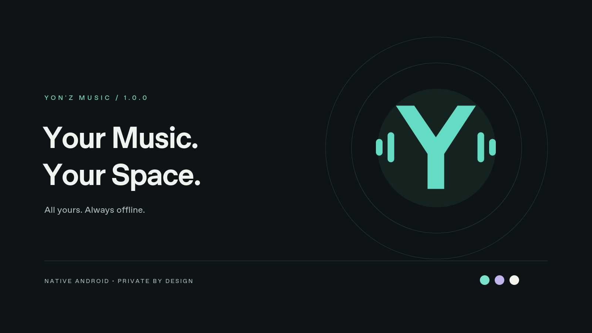

# Yon'z Music 1.0.0

Your Music. Your Space.

## Download v1.0.0

- **[Installable Android debug APK](https://github.com/arisynn/yonz-music/releases/download/v1.0.0/Yonz_Music_v1.0.0_debug.apk)** — Android 8.0+; development/debug signed.
- [Release page, source archive, assets and checksums](https://github.com/arisynn/yonz-music/releases/tag/v1.0.0).
- The optimized release APK is **unsigned** and requires the owner's production signing key before installation/distribution.

Verified: 44 JVM tests and 6 Android instrumentation tests passed; debug/release builds and lint completed with zero errors. Physical HyperOS and Play Protect approval are not claimed. See [test evidence](TEST_REPORT.md) and the [full build report](docs/FINAL_BUILD_REPORT.md).

A native Kotlin / Jetpack Compose Android player. No account, ads, analytics, internet permission, or remote startup dependency. All library and collection data stays on the device.

## Start listening

Install the debug APK from the delivery folder. Open **Library → Allow music access** to index Android's shared music library, or use **Import music → Local audio files / A music folder** to grant access to specific documents. Read permission is enough. Grant audio access again in Android settings if it was permanently declined.

Tap a song to play. The mini-player sits above navigation and opens Now Playing. Notification, lock-screen, Bluetooth, and wired media buttons use the same Media3 session. Unplugging headphones pauses playback. The player requests audio focus and follows Android interruption policy. Resume context is restored paused; tap Play to resume. MP3, AAC/M4A, FLAC, WAV, and OGG/Opus use the formats supported by the device's Media3/platform decoders.

**Playlists** owns custom collections; Favorites uses the same collection from Home or Playlists. Create/rename/delete collections, select songs, change order with arrows, and export M3U8. Deleting a playlist or removing a song only changes database references. Original music is never renamed, moved, retagged, or deleted.

## Bring your old lists

Use the single **Import music** destination (top-bar import icon). Choose TXT, CSV, JSON, M3U/M3U8, or paste one `Artist — Title` per line. Numbered/Markdown AI lists are accepted. CSV supports title/name/Track Name, artist/artists/Artist Name(s), and optional duration fields. JSON accepts arrays or tracks/songs/items arrays, including nested Spotify export metadata. UTF-8 and UTF-8 BOM are accepted.

Scan or choose your audio first. Review matched/unmatched/duplicate/invalid rows and create a named playlist from real matches. Titles alone match only when unambiguous; artist credits and supplied duration must agree. Live/remix versions remain distinct. Lists do not contain playable audio, and the app never downloads missing titles. Metadata imports are capped at 2 MB / 10,000 entries and 2,048 characters per entry; folder imports at 10,000 tracks / 20,000 directories. Import history retains row reports for completed imports.

M3U file paths are matched against indexed local filenames and metadata; they are never opened as arbitrary filesystem paths. Export uses content URI references, suitable for round trips on the same installation/library. References are not a portable backup of the audio or permission grants.

## Preferences and device behavior

Settings offers System/Dark/Light themes, an opaque surface option, reduced motion, sleep timer (15/30/45/60 minutes), and an intent to the device's system equalizer using the active audio-session ID (play a song first). A message explains when the equalizer is unavailable. Sleep timers pause playback and can be cancelled; they last for the current service process. They are not exact-alarm schedules across reboots.

On Xiaomi HyperOS, normal Android audio services can still be constrained by manufacturer battery settings. If playback stops when the screen is off, open Settings → Apps → Yon'z Music → Battery and permit background playback / No restrictions as appropriate for your HyperOS version. Menu names vary. The app does not force battery exemptions, acquire extra wake locks beyond Media3's playback-only CPU lock, or request autostart permissions. Physical Xiaomi testing has not been performed; see TEST_REPORT.md for actual validation.

## Source map

- `data/`: Room entities/DAO, transactional collection edits, DataStore, read-only MediaStore/SAF indexing.
- `importer/`: bounded format parsers and conservative local matching; no networking or file execution.
- `playback/`: MediaSessionService, one ExoPlayer, one controller, queue restoration and session sleep timer.
- `ui/`: shared design tokens, four main destinations, reusable filtered detail screen, artwork cache, settings/import and playback UI.
- `brand/`: original editable SVGs and high-resolution launcher preview.
- `app/src/test/`: parser, matching and collection ordering unit tests.
- `app/src/androidTest/`: real SQLite consistency tests when configured.

See BUILD_INSTRUCTIONS.md, SECURITY.md, LEGACY_MIGRATION_REPORT.md, TEST_REPORT.md and docs/FINAL_BUILD_REPORT.md. This is a first release build with documented testing limits; security-scanner/Play Protect approval is not guaranteed.
