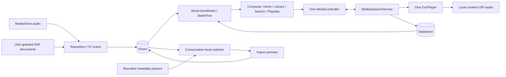

# Architecture and safety boundaries

All durable collection edits are Room transactions. Import history stores individually bounded rows instead of one large JSON blob, so a 10,000-row report can cross Android cursor windows safely. Metadata upserts preserve favorites, history and playlist references because those are independent tables. Missing media is marked unavailable. Playlist and queue ordering are explicit; imports use stable track IDs and one membership constraint. Playlist deletion cascades to memberships only.

Media3 owns audio focus, playback, media notifications, screen-off CPU wake handling, and headset controls. Playback state originates in the service and is mirrored by one controller. Controller initialization is deferred until after the first UI frame to keep library startup independent from player class initialization. Queue state is saved on timeline changes (including paused queue edits), playback changes and every ten seconds only while playing; restoration is paused and excludes unavailable items. Recent history is based on actual playback, not placeholder content.

The shared ViewModel never receives a progress tick. Only visible seek/progress components read position, under lifecycle STARTED, and only visible timer labels update their countdown. The sleep service uses one delayed coroutine, not polling. App-scoped sequential IO dispatch lets pending DataStore writes finish after orderly service destruction. Force-stop or power loss can lose the latest few seconds; Android does not permit guaranteeing execution after process death.

UI content uses Scaffold-consumed top/horizontal safe insets and a bottom bar that stacks the mini-player above navigation/system gesture padding. Lazy list content receives the full bottom-bar padding. Player controls use a scrollable full-screen dialog with safe drawing insets, so short landscape windows can reveal lower controls by scrolling. Sheets have capped scrollable content; text inputs resize with the IME. Reusable detail screens serve favorites, albums, artists, folders, history and playlists without duplicating collection state.

No parser opens a playlist file path or URL. Only content URIs indexed through MediaStore/Android document pickers can become playback items. Session clients cannot supply arbitrary network media. Import is metadata matching, never audio acquisition. No legacy executable code is reused.
